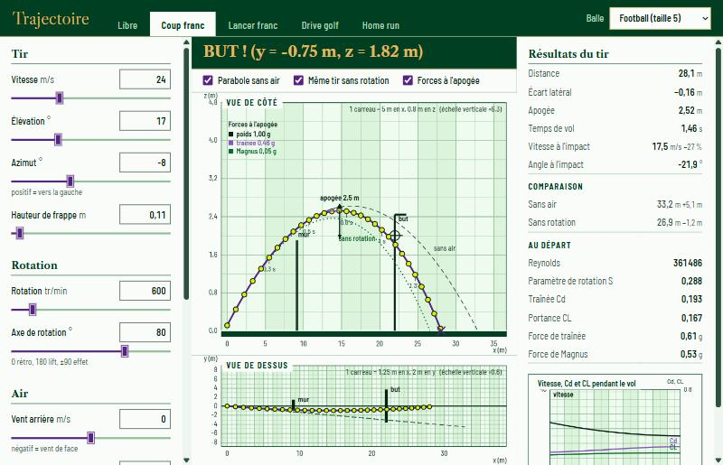

# balltraj — trajectoires de balles : traînée, effet Magnus et spin

[](../../actions/workflows/ci.yml)

Simulateur 3D du vol d'une balle de sport (football, basket, golf, tennis, baseball, volley).
Il intègre les équations du mouvement avec :
- la gravité ;
- la traînée aérodynamique, avec crise de traînée ;
- la portance de Magnus et la décroissance du spin ;
- le vent et l'atmosphère standard.



## Installation

```bash
python -m venv .venv
.venv\Scripts\activate          # Windows (Linux/macOS : source .venv/bin/activate)
pip install -e ".[dev]"
```

## Utilisation

```bash
trajectoire-web                               # interface web (ouvre http://127.0.0.1:8765)
trajectoire-web --port 9000 --no-browser      # autre port, sans ouvrir le navigateur
trajectoire                                   # ancienne interface matplotlib
trajectoire --scenario "Drive golf" --save capture.png   # image sans fenêtre
trajectoire-etude                             # régénère les graphiques de docs/figures/
```

## L'interface web

Une page unique servie en local (bibliothèque standard Python, rien n'est exposé sur le réseau). La physique reste en Python : le navigateur ne fait que dessiner ce que l'API calcule.

- **Direction visuelle « Centre Court »** : blanc, vert profond, violet, filets or et pelouse rayée, serif classique (Libre Caslon) pour les titres. Inspirée de l'univers du tennis de Wimbledon, sans reprendre aucun logo ni nom de marque. Polices embarquées, tout fonctionne hors ligne.
- **Le relevé** est à l'échelle : un carreau vaut un nombre rond de mètres, et l'échelle verticale est écrite quand elle diffère de l'horizontale. La balle est marquée à intervalles de temps réguliers, ce qui montre le freinage.
- **Comparaisons** : parabole sans air, même tir sans rotation, forces (poids, traînée, Magnus) à l'apogée.
- **Accessibilité** : onglets et réglages au clavier, texte alternatif des tracés, résultats aussi en tableau, `prefers-reduced-motion` respecté.
- **API** : `GET /api/meta`, `POST /api/simulate`, `/api/optimal`, `/api/target` (JSON) et `/api/export` (fichiers), testée sur un vrai serveur.

### Vue 3D immersive

Le bouton **Vue 3D** rejoue le tir en temps réel (three.js, embarqué en local, fonctionne hors ligne) :
- pelouse rayée avec ombres, ballon texturé qui **tourne vraiment** (la rotation vient de Python), tube violet tracé pendant le vol, balles fantômes à chaque intervalle de temps, anneaux aux points de contact ;
- **tableau d'affichage** en direct (temps, distance, hauteur, vitesse) et **barre de lecture** : lecture/pause, curseur de temps, vitesse de 0,1× à 2× (1× = temps réel), boucle ;
- **4 caméras** : Suivi (derrière la balle), Tribune (vue de côté), Aérien, Arrivée (depuis le but). Une rotation à la souris donne la main à la caméra libre.

### Rebonds et sol

Le réglage **Rebonds** (0 à 6), le choix de la **surface** (dur, gazon, terre battue) et **Roulé jusqu'à l'arrêt** donnent la distance totale d'un drive de golf (carry, rebonds, roulé). Le modèle d'impact est une sphère rigide à frottement de Coulomb : la balle accroche ou glisse selon sa rotation, un lift accélère le rebond et un rétro le freine.

### Export vers Autodesk Fusion

Le bouton **Script Fusion (.zip)** produit un dossier prêt à lancer dans Fusion (script Python + `.manifest`) : une sphère par instant de la chronophotographie, deux esquisses (profil et dessus) avec la courbe, un point par contact avec le sol. Il gère les modèles Z vers le haut et Y vers le haut, et les designs paramétriques ou directs. Le bouton **Données (.csv)** exporte les échantillons (t, x, y, z, vitesse).

Dans Fusion : dézipper, puis Utilitaires > Scripts et compléments > « + » > choisir le dossier > Exécuter. Les unités passent de mètres à centimètres. Le script est testé contre une fausse API Fusion (logique, repères, comptes), mais pas encore dans Fusion lui-même.

## Le simulateur interactif

- **Situations** : Libre, Coup franc (mur à 9,15 m, but à 22 m), Lancer franc, Drive golf, Home run.
  Chaque situation dessine le terrain et affiche un verdict (BUT !, PANIER !, HOME RUN !…).
- **Curseurs** : vitesse, élévation, azimut, hauteur de frappe, spin (tr/min), axe du spin,
  vent arrière et latéral, altitude, température.
- **Axe du spin** : 0° = rétro (backspin, la balle porte), 180° = lift (topspin, la balle plonge),
  +90° = effet qui enroule vers la gauche, −90° vers la droite.
- **Angle de portée max** : cherche l'élévation qui maximise la distance.
- **Viser la cible** : résout l'angle qui fait passer la balle par la cible (sous la barre, dans le cercle…).
- Courbes fantômes : parabole sans air (tirets) et même tir sans spin (pointillés).
- Graphique en bas à droite : vitesse, Cd et CL au cours du vol.

## Modèle physique

Repère : x vers l'avant, y vers la gauche, z vers le haut. Avec v_r = v − v_vent et k = ½ρA/m :

```
dv/dt = g − k·Cd(Re, S)·|v_r|·v_r + k·CL(S)·|v_r|·(ω × v_r)/|ω|
dω/dt = −ω/τ
Re = |v_r|·d/ν        S = r·|ω|/|v_r|
```

| Élément | Modèle | Fichier |
|---|---|---|
| Air | ISA (pression barométrique), gaz parfait, viscosité de Sutherland | `src/balltraj/atmosphere.py` |
| Traînée | Cd logistique en Re (crise de traînée) + terme induit par le spin | `src/balltraj/aero.py` |
| Magnus | CL = S / (1/pente + S/CL_max) | `src/balltraj/aero.py` |
| Balles | masses et diamètres réglementaires, coefficients issus de la littérature | `src/balltraj/balls.py` |
| Intégration | `solve_ivp` DOP853 (ordre 8), événements sol / apogée, sortie dense | `src/balltraj/simulate.py` |
| Problèmes inverses | angle optimal, angles passant par une cible, vitesse minimale | `src/balltraj/optimize.py` |

## Validation

96 tests, couverture 95 %. Ce qu'ils vérifient :
- **Sans air** : temps de vol, portée et apogée identiques à la solution analytique (à 1e-7 près), angle optimal 45°.
- **Magnus seul** : énergie mécanique conservée (la force est perpendiculaire à la vitesse).
- **Traînée** : énergie strictement décroissante, angle optimal < 45°.
- **Symétrie** : effets gauche et droite identiques ; spin toujours perpendiculaire à la vitesse.
- **Atmosphère** : valeurs des tables ISA.
- **Calibration** : drive type PGA Tour (74,6 m/s, 10,9°, 2 686 tr/min) → 239 m de carry (mesuré : ~251 m).
- **Situations de jeu et interface matplotlib**, testées sans fenêtre.
- **Rebonds** : norme ITF (tennis lâché de 2,54 m remonte de 1,35 à 1,47 m), énergie jamais créée par un impact, accroche = roulement pur, rotation et moment cinétique, roulé jusqu'à l'arrêt, backspin contre topspin.
- **Export** : script Fusion exécuté contre une fausse API (Z haut, Y haut, paramétrique), dossier zippé valide, téléchargements par le vrai serveur, tous les fichiers de la page servis.
- **API web** : mêmes verdicts que Python, forces cohérentes avec les équations (différences finies), entrées bornées, erreurs en JSON, serveur qui ne sort pas de son dossier.

## Résultats de l'étude

| | |
|---|---|
|  |  |
|  |  |

1. **Angle optimal** : 45° seulement à basse vitesse. Il descend vers 28–37° à 60 m/s.
2. **Golf** : carte du carry selon l'angle et le spin (voir les limites).
3. **Lancer franc** : effort minimal vers 50°, mais un tir plus en cloche tolère davantage les erreurs de vitesse.
4. **Altitude** : +3 à +5 % de distance à Denver ou Mexico.

## Limites connues

- **Golf** : l'optimum de carry sort vers 24° / 1 600 tr/min, au lieu de 15–17° / 2 000–2 200 mesurés. Cause : CL(S) est linéaire aux faibles spins.
- **Altitude** : ~+3 % de portée au baseball à Denver, contre ~+5 % mesurés.
- **Non modélisé** : rebonds, humidité, balles non sphériques.

La suite du projet est décrite dans [ROADMAP.md](ROADMAP.md), et les résultats sont suivis dans [docs/journal.md](docs/journal.md).

## Développement

```bash
pytest                                   # tests rapides ; tous : pytest -m ""
ruff check . && ruff format . && mypy    # à passer avant chaque commit (la CI le vérifie)
```

Méthode de travail : une branche `feat/...` par fonctionnalité, puis une pull request. La CI doit être verte avant le merge sur `main`.
