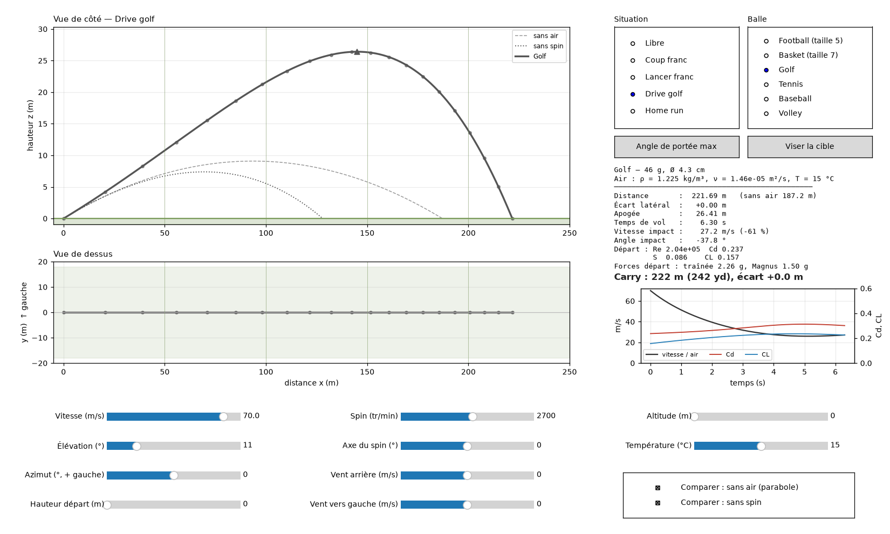
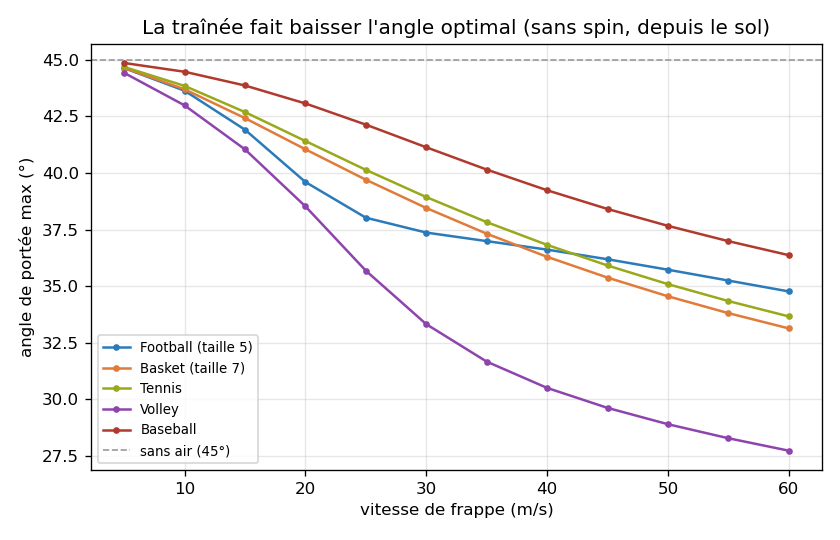
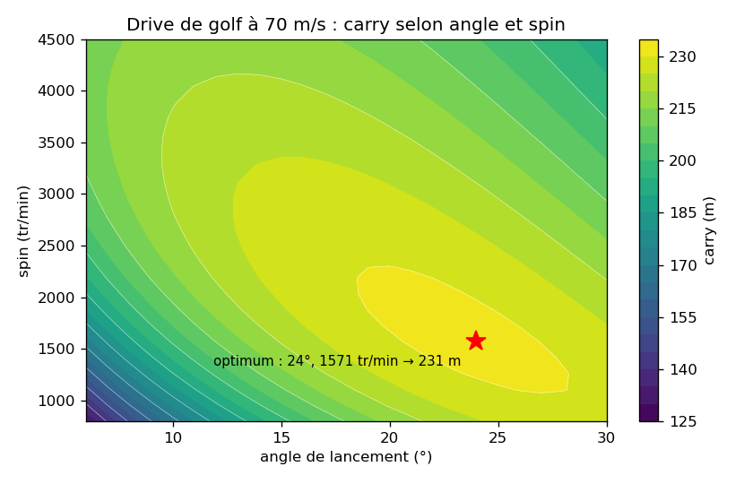
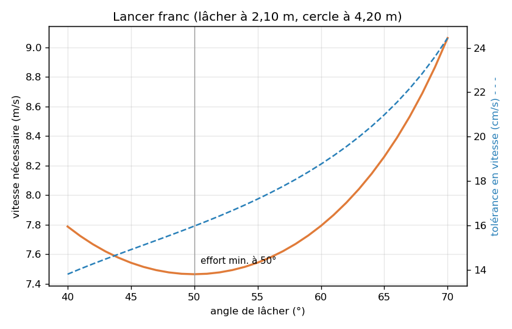
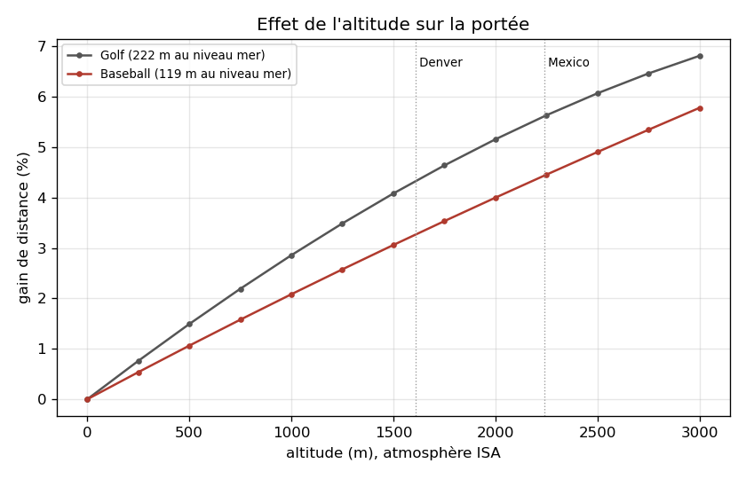

# balltraj — trajectoires de balles : traînée, effet Magnus et spin

[](../../actions/workflows/ci.yml)

Simulateur 3D du vol d'une balle de sport (football, basket, golf, tennis, baseball, volley).
Il intègre les équations du mouvement avec :
- la gravité ;
- la traînée aérodynamique, avec crise de traînée ;
- la portance de Magnus et la décroissance du spin ;
- le vent et l'atmosphère standard.



## Installation

```bash
python -m venv .venv
.venv\Scripts\activate          # Windows (Linux/macOS : source .venv/bin/activate)
pip install -e ".[dev]"
```

## Utilisation

```bash
trajectoire                                   # simulateur interactif
trajectoire --scenario "Drive golf" --save capture.png   # image sans fenêtre
trajectoire-etude                             # régénère les graphiques de docs/figures/
```

## Le simulateur interactif

- **Situations** : Libre, Coup franc (mur à 9,15 m, but à 22 m), Lancer franc, Drive golf, Home run.
  Chaque situation dessine le terrain et affiche un verdict (BUT !, PANIER !, HOME RUN !…).
- **Curseurs** : vitesse, élévation, azimut, hauteur de frappe, spin (tr/min), axe du spin,
  vent arrière et latéral, altitude, température.
- **Axe du spin** : 0° = rétro (backspin, la balle porte), 180° = lift (topspin, la balle plonge),
  +90° = effet qui enroule vers la gauche, −90° vers la droite.
- **Angle de portée max** : cherche l'élévation qui maximise la distance.
- **Viser la cible** : résout l'angle qui fait passer la balle par la cible (sous la barre, dans le cercle…).
- Courbes fantômes : parabole sans air (tirets) et même tir sans spin (pointillés).
- Graphique en bas à droite : vitesse, Cd et CL au cours du vol.

## Modèle physique

Repère : x vers l'avant, y vers la gauche, z vers le haut. Avec v_r = v − v_vent et k = ½ρA/m :

```
dv/dt = g − k·Cd(Re, S)·|v_r|·v_r + k·CL(S)·|v_r|·(ω × v_r)/|ω|
dω/dt = −ω/τ
Re = |v_r|·d/ν        S = r·|ω|/|v_r|
```

| Élément | Modèle | Fichier |
|---|---|---|
| Air | ISA (pression barométrique), gaz parfait, viscosité de Sutherland | `src/balltraj/atmosphere.py` |
| Traînée | Cd logistique en Re (crise de traînée) + terme induit par le spin | `src/balltraj/aero.py` |
| Magnus | CL = S / (1/pente + S/CL_max) | `src/balltraj/aero.py` |
| Balles | masses et diamètres réglementaires, coefficients issus de la littérature | `src/balltraj/balls.py` |
| Intégration | `solve_ivp` DOP853 (ordre 8), événements sol / apogée, sortie dense | `src/balltraj/simulate.py` |
| Problèmes inverses | angle optimal, angles passant par une cible, vitesse minimale | `src/balltraj/optimize.py` |

## Validation

28 tests, couverture 97 %. Ce qu'ils vérifient :
- **Sans air** : temps de vol, portée et apogée identiques à la solution analytique (à 1e-7 près), angle optimal 45°.
- **Magnus seul** : énergie mécanique conservée (la force est perpendiculaire à la vitesse).
- **Traînée** : énergie strictement décroissante, angle optimal < 45°.
- **Symétrie** : effets gauche et droite identiques ; spin toujours perpendiculaire à la vitesse.
- **Atmosphère** : valeurs des tables ISA.
- **Calibration** : drive type PGA Tour (74,6 m/s, 10,9°, 2 686 tr/min) → 239 m de carry (mesuré : ~251 m).
- **Situations de jeu et interface**, testées sans fenêtre.

## Résultats de l'étude

| | |
|---|---|
|  |  |
|  |  |

1. **Angle optimal** : 45° seulement à basse vitesse. Il descend vers 28–37° à 60 m/s.
2. **Golf** : carte du carry selon l'angle et le spin (voir les limites).
3. **Lancer franc** : effort minimal vers 50°, mais un tir plus en cloche tolère davantage les erreurs de vitesse.
4. **Altitude** : +3 à +5 % de distance à Denver ou Mexico.

## Limites connues

- **Golf** : l'optimum de carry sort vers 24° / 1 600 tr/min, au lieu de 15–17° / 2 000–2 200 mesurés. Cause : CL(S) est linéaire aux faibles spins.
- **Altitude** : ~+3 % de portée au baseball à Denver, contre ~+5 % mesurés.
- **Non modélisé** : rebonds, humidité, balles non sphériques.

La suite du projet est décrite dans [ROADMAP.md](ROADMAP.md), et les résultats sont suivis dans [docs/journal.md](docs/journal.md).

## Développement

```bash
pytest                                   # tests rapides ; tous : pytest -m ""
ruff check . && ruff format . && mypy    # à passer avant chaque commit (la CI le vérifie)
```

Méthode de travail : une branche `feat/...` par fonctionnalité, puis une pull request. La CI doit être verte avant le merge sur `main`.
